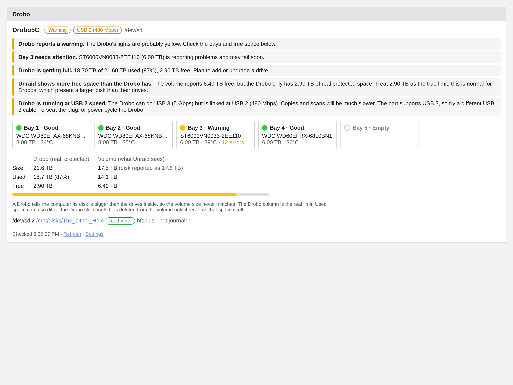

# Drobo for Unraid

An Unraid plugin that shows a USB-attached Drobo's health on the **Main** tab and sends Unraid notifications when something changes. It is **read-only**: it never changes anything on the Drobo or its drives.



## What it shows

- **Each bay**: drive model, size, temperature, error count, and health (good, warning, failed, empty), with lights coloured like the Drobo's own.
- **Overall status** the Drobo reports, and whether it is **rebuilding** data protection.
- **Capacity, two ways**: the Drobo's real protected space next to what Unraid sees for the volume. A Drobo presents a disk bigger than its drives (often 16 TB or 64 TB), so the volume's free space can be far more than the Drobo really has. The plugin warns when that gap matters.
- **USB link speed**, with a warning when a USB 3 Drobo has linked at USB 2 and a hint whether the port or the cable is to blame.
- **HFS+ volume state**: read-only mounts, volumes that were not cleanly unmounted, and volumes flagged for repair.

## Notifications

With background checks on (every 5 minutes by default), you get one Unraid notification when a problem starts and one when it clears: a failed or failing drive, a rebuild, the Drobo getting full (85% / 95% by default), USB 2 speed, a read-only or unclean volume, or the Drobo disconnecting. Change this under **Settings → User Utilities → Drobo**.

## Install

In Unraid, go to **Plugins → Install Plugin** and paste:

```
https://github.com/yeixio/unraid-drobo/releases/latest/download/drobo.plg
```

Unraid 6.12 or later.

## Which Drobos work

It talks to the Drobo's management channel with standard SCSI `MODE SENSE` reads, the same way [droboctl](https://github.com/ryngrn/droboctl) does. That works on the Drobo 5D; the 5C uses the same firmware family and is expected to work. Older models (Gen1/Gen2, FS, Pro) speak a different protocol and are not supported; if your Drobo doesn't answer, the panel still shows USB speed and the volume, and says the Drobo's own status couldn't be read.

From a terminal on the server you can run:

```
drobo-status text
```

## How it works

- `drobo-status` is a small Go program (about 2 MB). It runs for about a second when the Main page asks for status (cached for 20 seconds) and from cron for background checks. Nothing stays running.
- It only sends SCSI `INQUIRY` and `MODE SENSE(10)`; any other command is refused in code.
- It reads the HFS+ volume header (512 bytes) read-only to check the clean-unmount flag.

## Building

```
go test ./...
build/package.sh 2026.11.19   # dist/drobo-2026.11.19-x86_64-1.txz and dist/drobo.plg
```

To publish, run the **Release** workflow from the Actions tab with a version such as `2026.11.19` (or push a tag `v2026.11.19`). It builds and publishes a GitHub release with both files, and Unraid picks up the update from there.

## Credits

The SCSI and ESA page parsing is adapted from [droboctl](https://github.com/ryngrn/droboctl) by Ryan Green (MIT). See [NOTICE](NOTICE).
